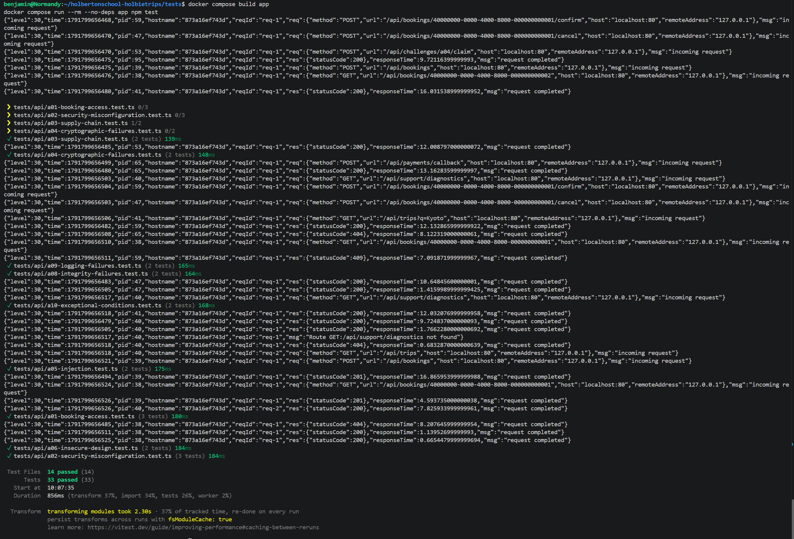

# A01 - Boarding Pass Mix-Up

## Vulnerability

La route `GET /api/bookings/:id` de l'API HolbieTrips souffre d'un contrôle d'accès défaillant de type **IDOR (Insecure Direct Object Reference)**, correspondant à la catégorie **OWASP A01:2025 – Broken Access Control**.

N'importe quel voyageur authentifié peut consulter les détails complets de la réservation d'un autre voyageur en connaissant simplement son identifiant UUID, sans qu'aucune vérification de propriété ne soit effectuée côté serveur. Les données exposées incluent des informations sensibles : nom complet, email, statut de paiement, et les quatre derniers chiffres de la carte bancaire du voyageur concerné.

## Exploitation

1. Connexion à l'application avec un compte client standard (Bruno Dupont).
2. Observation, via l'onglet Network des DevTools, de l'appel `GET /api/bookings/:id` déclenché lors de l'affichage du détail d'une réservation.
3. Récupération d'un token de session valide (header `Authorization: Bearer <token>`) depuis une requête authentifiée en cours.
4. Rejeu manuel de cette requête depuis la console du navigateur, en remplaçant l'identifiant de réservation par celui d'une réservation appartenant à un autre compte (Alice Martin), tout en conservant le token de Bruno.
5. La réponse renvoie un code `200 OK` avec l'intégralité des données de la réservation d'Alice, incluant le flag `FLAG{a01_4c038c8ea43ccf9a4995493f}` injecté dans le champ `itinerary_notes`.

Aucune donnée n'a été modifiée ou supprimée : l'exploitation s'est limitée à une lecture, dans l'environnement local du laboratoire, avec les comptes de démonstration fournis.

## Root Cause

Le handler de la route interrogeait la base de données en filtrant uniquement sur l'identifiant de la réservation :

```sql
SELECT ... FROM bookings b
JOIN trips t ON t.id=b.trip_id
JOIN users u ON u.id=b.user_id
LEFT JOIN payments p ON p.booking_id=b.id
WHERE b.id=$1
```

Aucune clause ne restreignait le résultat à l'utilisateur authentifié (`request.authUser.id`), contrairement à la route de liste `GET /api/bookings`, qui filtre correctement par `WHERE b.user_id=$1`.

Le code contenait bien une comparaison entre `booking.user_id` et l'utilisateur courant, mais celle-ci ne servait pas de contrôle d'accès : elle ne faisait qu'enrichir la réponse avec le flag de démonstration lorsque la condition d'accès non autorisé était remplie, sans jamais bloquer ni refuser la requête. Le flag matérialisait donc la faille plutôt que la cause elle-même.

## Remediation

Le handler a été corrigé pour vérifier explicitement les droits d'accès après récupération de la réservation, en autorisant deux cas légitimes :

```js
const booking = result.rows[0];
const isOwner = booking.user_id === request.authUser!.id;
const isSupport = request.authUser!.role === 'support';
if (!isOwner && !isSupport) {
  return reply.code(404).send({ error: 'Réservation introuvable' });
}

return { booking };
```

- **Propriétaire** (`isOwner`) : un client peut toujours consulter sa propre réservation.
- **Support** (`isSupport`) : un agent support peut consulter n'importe quelle réservation via son identifiant, conformément au besoin métier.
- Dans tout autre cas, la requête est rejetée avec un code `404 Not Found` et un message générique (`Réservation introuvable`), cohérent avec le style déjà utilisé ailleurs dans le fichier (ex. route `cancel`). Le choix du `404` plutôt que `403` évite de révéler à un tiers non autorisé l'existence même de la ressource.

## Verification

Trois tests ont été ajoutés ou mis à jour dans `tests/api/a01-booking-access.test.ts` :

1. **Régression de sécurité** : un client authentifié (Alice) tentant de lire la réservation d'un autre client (Bruno) reçoit désormais `404` avec le message `Réservation introuvable`, au lieu du `200` et du flag précédemment exposés.
2. **Parcours positif propriétaire** : un client authentifié peut toujours lire sa propre réservation (`200`, données correctes).
3. **Parcours positif support** : un agent avec le rôle `support` peut toujours lire n'importe quelle réservation via son identifiant (`200`, données correctes).

L'ensemble de la suite de tests (33 tests, 14 fichiers) passe avec succès après application du correctif.

