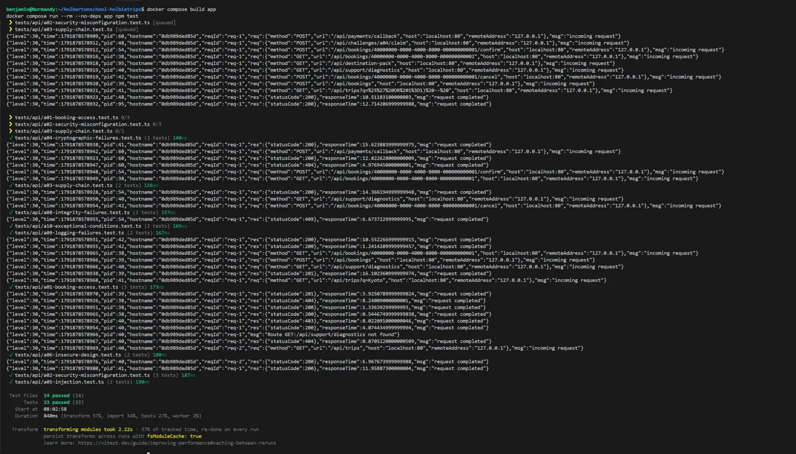

# A02 - The Debug Desk Left Open

## Vulnerability

La route `GET /api/support/diagnostics` de l'API HolbieTrips souffre d'une **mauvaise configuration de sécurité** (OWASP A02:2025 - Security Misconfiguration). Un panneau de diagnostic interne, destiné exclusivement à l'équipe support, était à la fois activé en permanence par une variable d'environnement de développement laissée active, et insuffisamment protégé : n'importe quel client authentifié (sans rôle particulier) pouvait y accéder.

La réponse expose des informations sensibles destinées aux opérateurs : la topologie des services internes (adresses de la base de données, du simulateur de paiement, du simulateur mail), la version runtime du serveur, et un indicateur explicite (`intendedAudience: "support"`) confirmant que l'accès client n'était pas prévu.

## Exploitation

1. Connexion à l'application avec un compte client standard.
2. Observation, dans l'onglet Network des DevTools, des en-têtes de réponse d'un appel API ordinaire (`GET /api/support/tickets`).
3. Repérage d'un en-tête personnalisé inhabituel : `X-Holbietrips-Debug-Desk: /api/support/diagnostics`.
4. Rejeu de cette URL via `fetch()` dans la console du navigateur, en conservant le token de session du compte client.
5. La réponse renvoie un code `200 OK` avec l'intégralité du panneau de diagnostic, incluant le flag `FLAG{a02_0d22ac728f447b12091a0b5f}` et le commentaire interne de l'équipe : *"If a customer can read this, the Debug Desk was left open."*

Aucune donnée n'a été modifiée : l'exploitation s'est limitée à une lecture, en local, avec un compte de démonstration.

## Root Cause

Deux défauts indépendants se combinaient :

**1. Configuration runtime dangereuse.** La route n'était enregistrée que si la variable d'environnement `SUPPORT_DIAGNOSTICS_ENABLED` était active (`.env.example` et `compose.yaml` la définissaient à `true`) :
```js
if (!diagnosticsEnabled) return;
app.get('/api/support/diagnostics', ...)
```
Une fonctionnalité de debug typiquement utile en développement était ainsi restée active dans un environnement se présentant lui-même comme `production` (`runtime.environment` dans la réponse); une incohérence symptomatique d'une mauvaise gestion de configuration entre environnements.

**2. Autorisation insuffisante.** Même la route activée aurait dû vérifier le rôle de l'appelant. Or elle utilisait seulement `preHandler: context.requireUser`, qui vérifie uniquement qu'un utilisateur est authentifié, sans contrôler son rôle; contrairement aux routes du module support (`support.ts`) qui utilisent déjà `context.requireRole('support')`. Le champ `intendedAudience: 'support'` dans la réponse n'était qu'indicatif, sans portée réelle sur le contrôle d'accès.

Un en-tête de réponse global (`X-Holbietrips-Debug-Desk`), posé par un hook `onSend` dès que `diagnosticsEnabled` est actif, facilitait la découverte du chemin mais n'était pas lui-même la cause de la vulnérabilité : l'accès restait possible en appelant directement l'URL, avec ou sans connaissance de ce header.

## Remediation

La correction applique une défense en profondeur sur les deux couches identifiées :

**1. Autorisation par rôle**, dans `system.ts` :
```js
app.get('/api/support/diagnostics', { preHandler: context.requireRole('support') }, async () => ({
  ...
}));
```
Un client authentifié reçoit désormais `403 Forbidden` (`{ error: 'Accès refusé' }`) ; un agent support reçoit toujours `200` avec les données attendues.

**2. Configuration par défaut sécurisée**, dans `.env.example` et `compose.yaml` :

Avec les diagnostics désactivés, la route n'est plus enregistrée du tout et renvoie `404 Not Found` (`{ error: 'Ressource introuvable' }`) à toute requête, sans fuite d'information sur son existence.

Ces deux corrections sont indépendantes l'une de l'autre : même si la variable d'environnement était réactivée par erreur, la vérification de rôle continuerait de bloquer l'accès client — conformément à l'exigence du briefing que la route reste inaccessible *"even if diagnostics are enabled again by mistake"*.

## Verification

Trois tests ont été ajoutés ou mis à jour dans `tests/api/a02-security-misconfiguration.test.ts` :

1. **Régression de sécurité** : un client authentifié, avec les diagnostics activés, reçoit désormais `403` et le message `Accès refusé` au lieu du `200` et du flag précédemment exposés.
2. **Parcours positif support** : un agent avec le rôle `support`, diagnostics activés, peut toujours consulter le panneau de diagnostic (`200`, `intendedAudience: "support"`).
3. **Non-régression métier** : avec les diagnostics désactivés, le catalogue public de voyages (`GET /api/trips`) reste pleinement fonctionnel (`200`), tandis que la route de diagnostic renvoie `404` sans l'en-tête `X-Holbietrips-Debug-Desk`.

L'ensemble de la suite de tests (33 tests, 14 fichiers) passe avec succès après application du correctif.

